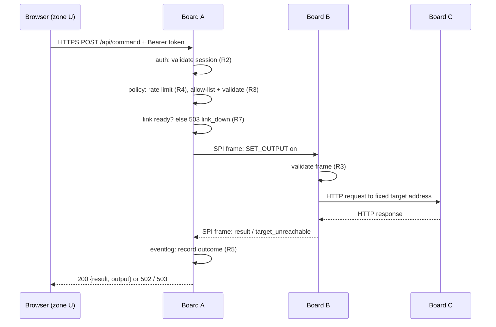

# Architecture

## Topology

```
  [legitimate users and attackers on the normal Wi-Fi network]
            |  HTTPS, port 443, the only exposed service
  +---------+------------------------------+
  | BOARD A  "station board"               |  joins existing Wi-Fi
  |   HTTPS server, authentication,        |  SPI controller
  |   command allow-list, rate limiting,   |
  |   event log, and the WEB INTERFACE     |
  +---------+------------------------------+
            |  wired SPI link: SCLK, MOSI, MISO, CS, plus a handshake
            |  line, <= 10 MHz. THIS IS THE ONLY PATH between the
            |  two networks. No IP forwarding, no bridging, no NAT.
  +---------+------------------------------+
  | BOARD B  "bridge board"                |  hosts a private Wi-Fi AP
  |   SPI peripheral, frame validation,    |  SPI peripheral
  |   fixed-target HTTP client             |
  +---------+------------------------------+
            |  private Wi-Fi, password withheld from ordinary users
  +---------+------------------------------+
  | BOARD C  "target device"               |  deliberately insecure
  |   hardcoded credentials, no auth,      |
  |   plain HTTP, controls an LED          |
  +----------------------------------------+
```

All three boards are ESP32-S3-DevKitC-1.

## Security argument

Each board has its own radio, and the boards share no network stack. So no
software path on a single device can carry a request from the user network to
the target. A request must be **authorized on Board A** and then **re-issued
across the wire by Board B**.

Board B never forwards raw packets or arbitrary URLs. It accepts only
well-formed SPI frames that encode an allow-listed operation. It then performs
that operation against one **fixed** target address that is compiled into its
firmware (R3: clients cannot choose a destination).

## Trust zones

| Zone | Contents | Trust | Boundary control |
|---|---|---|---|
| **U** user network | Users' browsers, attackers, everything else on the normal Wi-Fi | Untrusted | TLS, authentication, allow-list, rate limits on Board A |
| **A** station board | HTTPS server, sessions, policy, event log, SPI controller | Trusted, internet-facing | The only service exposed to U is HTTPS on port 443 |
| **L** SPI link | Physical wires between A and B | Trusted by physical control | Fixed frame format, length and type validation on both ends |
| **B** bridge board | SPI peripheral, private AP, fixed-target HTTP client | Trusted, not reachable from U | No IP route to U; accepts only valid frames |
| **T** target network | Board C on Board B's private AP | Untrusted device in an isolated network | AP password withheld; C never joins U (R1) |

## Request flow: `POST /api/command {"action":"led_on"}`



Every step that can fail ends the request with an error response from
[api-contract.md](api-contract.md), and the target is left unchanged (R6).

## Failure and restart behavior (R7)

| Event | Required behavior |
|---|---|
| Board A boots | No sessions exist. Commands return 503 until the SPI link reports ready. |
| Board B boots or resets | The link reports not ready. Board A returns 503 for commands. In-flight requests are discarded, not replayed. |
| SPI link broken | Same as Board B down. No fallback path to the target exists. |
| Target unreachable | Board A returns 502. The event log records a `target` / `alert` entry. |
| Board A loses user Wi-Fi | No users can connect. Nothing changes for the target. |

The details of link readiness and request invalidation are defined in
[spi-protocol.md](spi-protocol.md) (TODO).

## Web interface delivery

Board A serves the web interface from a LittleFS partition (see
`firmware/station-board/partitions.csv`). The assets are pre-minified and
gzipped by `web/scripts/build.py` and must stay within a 60 KB gzipped budget,
because flash and RAM are shared with mbedTLS buffers and the event log. The
page polls `GET /api/status` (default every 2000 ms) instead of using a
WebSocket, which would cost an extra socket and TLS context.
